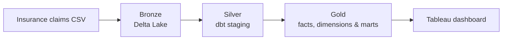
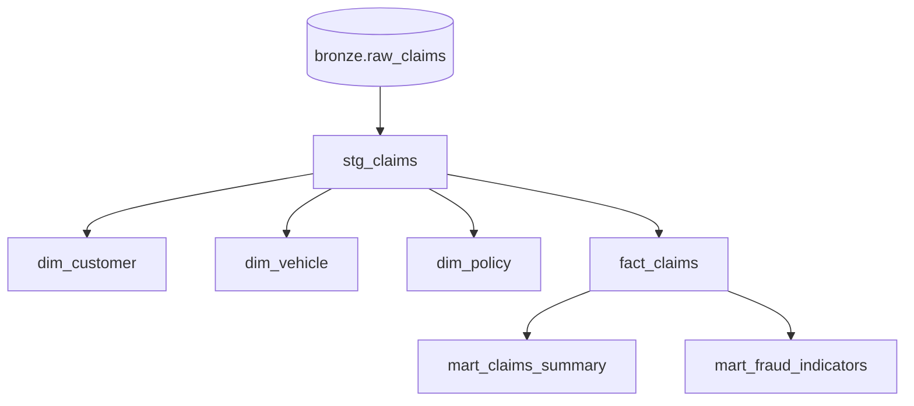
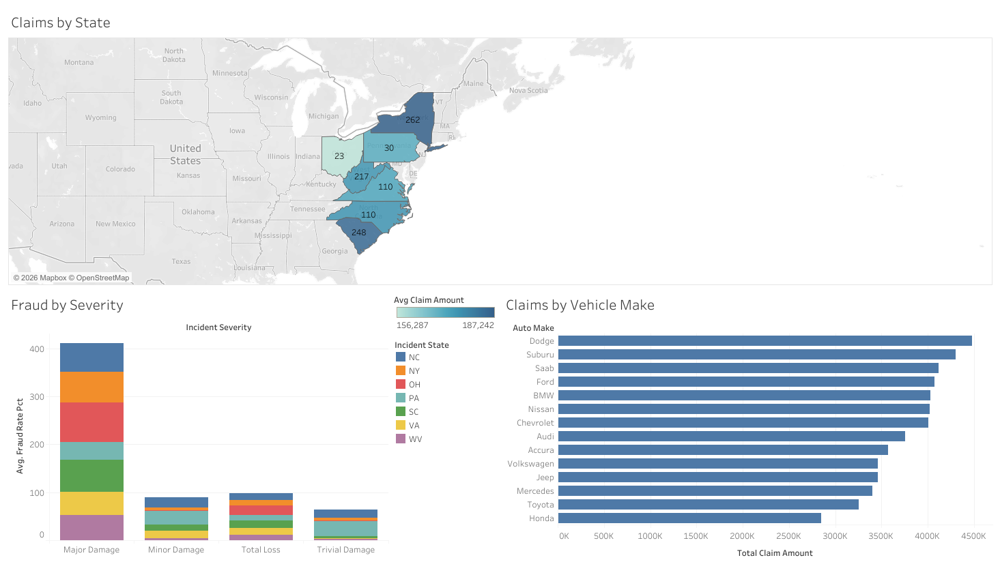
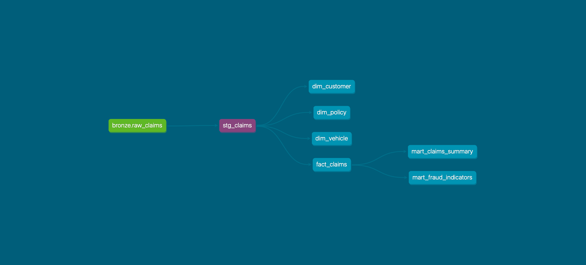

# Insurance Claims Pipeline

**Databricks · dbt · SQL · PySpark · Tableau**

I built this project to turn a raw auto-insurance claims dataset into something easier to explore and report on. The data starts in a Databricks Delta table, goes through dbt models for cleaning and analysis, and ends in a [Tableau dashboard](https://public.tableau.com/app/profile/vanilton.paulo/viz/InsuranceClaimsAnalysis_17933994207990/InsuranceClaimsAnalysis?publish=yes).

**[Explore the interactive dashboard ↗](https://public.tableau.com/app/profile/vanilton.paulo/viz/InsuranceClaimsAnalysis_17933994207990/InsuranceClaimsAnalysis?publish=yes)**

## The pipeline



- **Bronze:** Ingest the source CSV into Databricks with PySpark and retain the raw records in Delta Lake.
- **Silver:** Use `stg_claims` to fix column names, cast data types, clean categorical fields and turn the original Y/N fraud flag into a boolean.
- **Gold:** Build customer, vehicle and policy dimensions; a claims fact table; and two reporting marts.
- **Tableau:** Explore claims and incident data through the published dashboard.

## dbt models

| Model | Purpose |
| --- | --- |
| `stg_claims` | Standardizes the raw insurance claims data. |
| `dim_customer`, `dim_vehicle`, `dim_policy` | Descriptive attributes for claims analysis. |
| `fact_claims` | Claim amounts, incident details and dimension keys. |
| `mart_claims_summary` | Claims volume, average claim amount and fraud rate by state and severity. |
| `mart_fraud_indicators` | Four rule-based flags and a combined risk score for each claim. |

The fraud indicator is **a rule-based score, not a trained fraud prediction model**. It considers unusually high claim amounts, missing witnesses, unavailable police reports and unreported property damage.

## Model lineage

This diagram follows the dependencies defined in the dbt models; it renders directly on GitHub without a separate screenshot.



## Tableau dashboard

**[Open the published Insurance Claims Analysis dashboard](https://public.tableau.com/app/profile/vanilton.paulo/viz/InsuranceClaimsAnalysis_17933994207990/InsuranceClaimsAnalysis?publish=yes)**

<!-- Once docs/dashboard-screenshot.png is committed to this repository, uncomment the line below:

-->


## Data Lineage



## Testing and CI

I use dbt tests to check keys, required values and relationships between the fact and dimension models. GitHub Actions runs dbt against Databricks on the CI target; the workflow also includes Python and YAML checks as part of the code-quality work.

The goal here is to catch model and data-quality issues before merging changes, rather than relying only on manual runs.

## Run the dbt project

You'll need Python 3.13, [uv](https://docs.astral.sh/uv/), a Databricks SQL warehouse, and an existing Bronze `raw_claims` table.

```bash
git clone https://github.com/vaniltonpaulo/insurance-claim-pipeline.git
cd insurance-claim-pipeline
uv sync --locked
cd insurance_claims_pipeline

# Configure your Databricks credentials in your local dbt profile first.
uv run --project .. dbt debug
uv run --project .. dbt deps
uv run --project .. dbt build
```

The project reads Databricks connection settings from your dbt profile / environment variables. Don't commit access tokens or other credentials.

## Tools

`Databricks` · `Delta Lake` · `PySpark` · `dbt Core` · `SQL` · `GitHub Actions` · `uv` · `Tableau Public`

---
