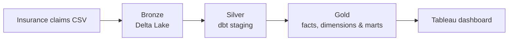
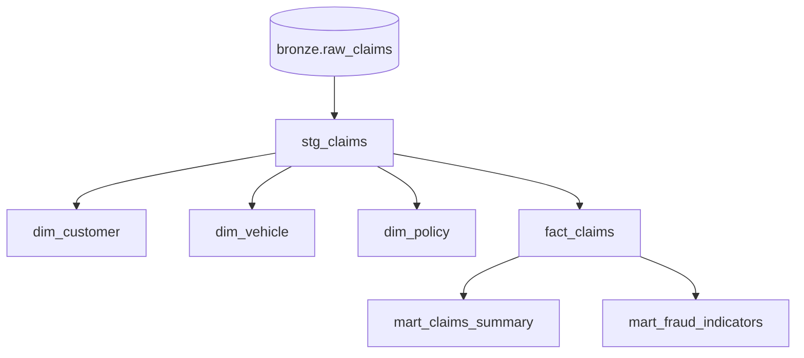
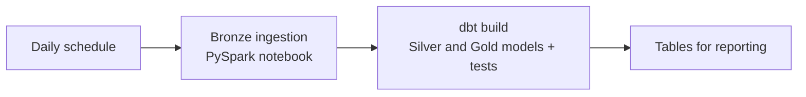
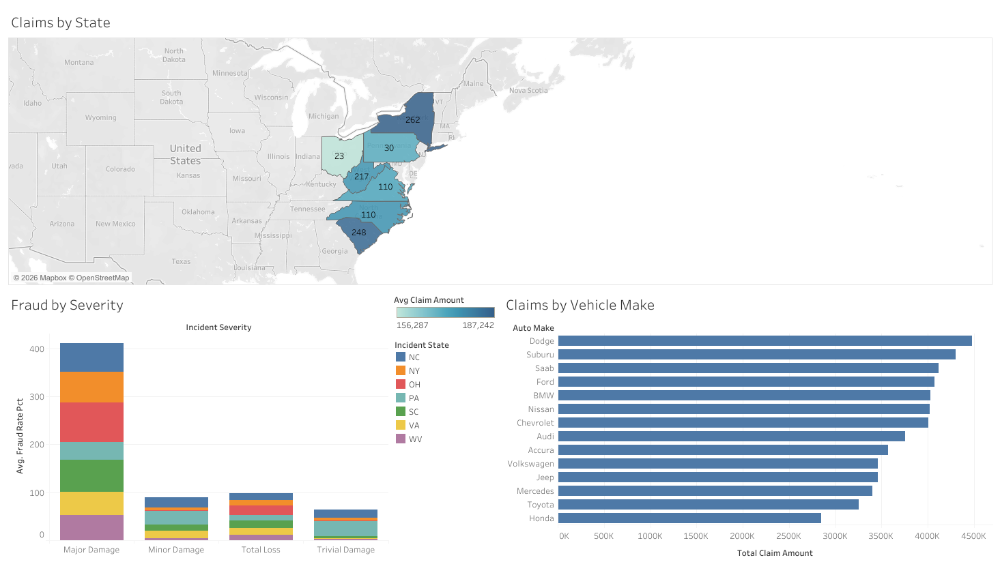
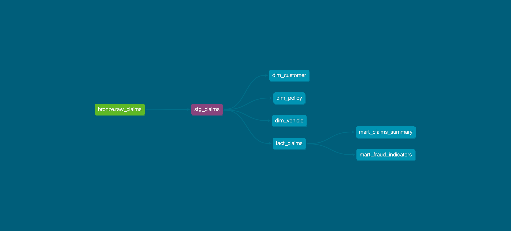
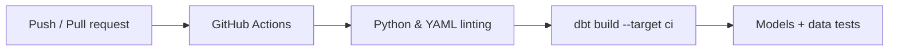

# Insurance Claims Pipeline

**Databricks · dbt · SQL · PySpark · Tableau**

I built this project to turn a raw auto-insurance claims dataset into something easier to explore and report on. The data starts in a Databricks Delta table, goes through dbt models for cleaning and analysis, and ends in a [Tableau dashboard](https://public.tableau.com/app/profile/vanilton.paulo/viz/InsuranceClaimsAnalysis_17933994207990/InsuranceClaimsAnalysis?publish=yes).

**[Explore the interactive dashboard ↗](https://public.tableau.com/app/profile/vanilton.paulo/viz/InsuranceClaimsAnalysis_17933994207990/InsuranceClaimsAnalysis?publish=yes)**

## The pipeline



- **Bronze:** Ingest the source CSV into Databricks with PySpark and retain the raw records in Delta Lake.
- **Silver:** Use `stg_claims` to fix column names, cast data types, clean categorical fields and turn the original Y/N fraud flag into a boolean. Incremental processing avoids re-reading all historical records on every run.
- **Gold:** Build customer, vehicle and policy dimensions; a claims fact table; and two reporting marts.
- **Tableau:** Explore claims and incident data through the published dashboard.

## dbt models

| Model | Purpose |
| --- | --- |
| `stg_claims` | Incrementally standardizes the raw insurance claims data. |
| `dim_customer`, `dim_vehicle`, `dim_policy` | Descriptive attributes for claims analysis. |
| `fact_claims` | Claim amounts, incident details and dimension keys. |
| `mart_claims_summary` | Claims volume, average claim amount and fraud rate by state and severity. |
| `mart_fraud_indicators` | Four rule-based flags and a combined risk score for each claim. |

The fraud indicator is **a rule-based score, not a trained fraud prediction model**. It considers unusually high claim amounts, missing witnesses, unavailable police reports and unreported property damage.

## Model lineage

This diagram follows the dependencies defined in the dbt models; it renders directly on GitHub without a separate screenshot.



## Incremental loading

`stg_claims` is materialized as an **incremental Delta table** instead of being rebuilt from scratch on every run. The model uses `_ingested_at` to identify newly ingested records and `policy_number` as the key for Delta Lake's `merge` strategy.

```sql
{{
    config(
        materialized='incremental',
        unique_key='policy_number',
        incremental_strategy='merge'
    )
}}

WITH source AS (
    SELECT *
    FROM {{ source('bronze', 'raw_claims') }}

    
    WHERE _ingested_at > (
        SELECT MAX(_ingested_at) FROM {{ this }}
    )
    
)
-- Cleaning and type conversions follow.
```

- **First run / full refresh:** Load the complete Bronze dataset and create the Silver table.
- **Later runs:** Read only records with `_ingested_at` later than the latest value already processed.
- **Merge:** Insert new policies and update existing policies included in the incoming batch.

To rebuild the entire staging table after a structural change:

```bash
dbt run --select stg_claims --full-refresh --target dev --profiles-dir .
```

For normal incremental runs, omit `--full-refresh`:

```bash
dbt run --select stg_claims --target dev --profiles-dir .
```

**Tradeoff:** This timestamp-based filter assumes ingestion timestamps move forward. Late-arriving records with older timestamps, or multiple records sharing the same timestamp, need extra handling (for example a lookback window and deduplication). `policy_number` also needs to be unique in each merge batch.

## Orchestration and scheduling

The Databricks Jobs / Workflows setup is designed to run the pipeline **once per day**, with Bronze ingestion completing before the dbt transformations begin.



The dependency matters: dbt should not transform the data until ingestion finishes successfully. A full automated run requires the workflow's ingestion and dbt tasks to be connected and executable; a saved daily trigger alone does not establish that both tasks run successfully.

GitHub Actions serves a different purpose: **CI validates code changes on pull requests and pushes to `main`**. It is not the same as the daily data-refresh job.

## Source freshness monitoring

dbt can monitor whether Bronze is receiving data by checking the latest `_ingested_at` value. The following configuration can be added to `models/staging/_sources.yml` if it is not already present:

```yaml
version: 2

sources:
  - name: bronze
    database: insurance
    schema: bronze
    config:
      loaded_at_field: _ingested_at
      freshness:
        warn_after: {count: 24, period: hour}
        error_after: {count: 48, period: hour}
    tables:
      - name: raw_claims
```

- **24 hours without new data:** Warn.
- **48 hours without new data:** Error.

Run the check explicitly:

```bash
dbt source freshness --target dev --profiles-dir .
```

This check needs to be added as a scheduled job step if you want automatic monitoring; `dbt build` alone does not execute `dbt source freshness`.

## Tableau dashboard

**[Open the published Insurance Claims Analysis dashboard](https://public.tableau.com/app/profile/vanilton.paulo/viz/InsuranceClaimsAnalysis_17933994207990/InsuranceClaimsAnalysis?publish=yes)**



## Data lineage



## Testing and CI

I use dbt tests to check keys, required values and relationships between the fact and dimension models. GitHub Actions runs dbt against Databricks on the `ci` target; the workflow also includes Python and YAML checks as part of the code-quality work.



The goal is to catch model and data-quality issues before merging changes, rather than relying only on manual runs. The CI target chooses the dbt profile; **schema naming must also be configured to keep CI tables separate from development or shared Silver/Gold tables**.

## Run the dbt project

You'll need Python 3.13, [uv](https://docs.astral.sh/uv/), a Databricks SQL warehouse, and an existing Bronze `raw_claims` table.

```bash
git clone https://github.com/vaniltonpaulo/insurance-claim-pipeline.git
cd insurance-claim-pipeline
uv sync --locked
cd insurance_claims_pipeline

# Provide DBT_DATABRICKS_HOST, DBT_DATABRICKS_HTTP_PATH,
# and DBT_DATABRICKS_TOKEN through your shell environment.
uv run --project .. dbt debug --target dev --profiles-dir .
uv run --project .. dbt deps --profiles-dir .
uv run --project .. dbt build --target dev --profiles-dir .
```

The project reads Databricks connection settings from environment variables. A local `.env` can be used if loaded into the shell first; keep it in `.gitignore`. Don't commit access tokens or other credentials.

## Tools

`Databricks` · `Delta Lake` · `PySpark` · `dbt Core` · `SQL` · `GitHub Actions` · `Databricks Workflows` · `uv` · `Tableau Public`

---
